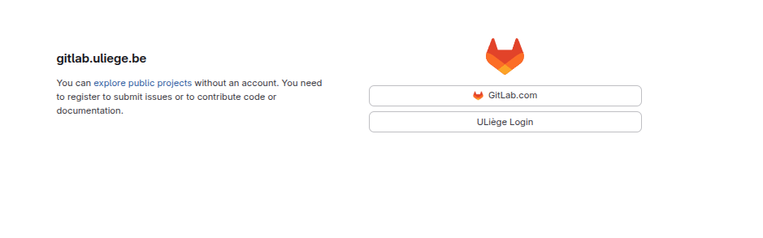
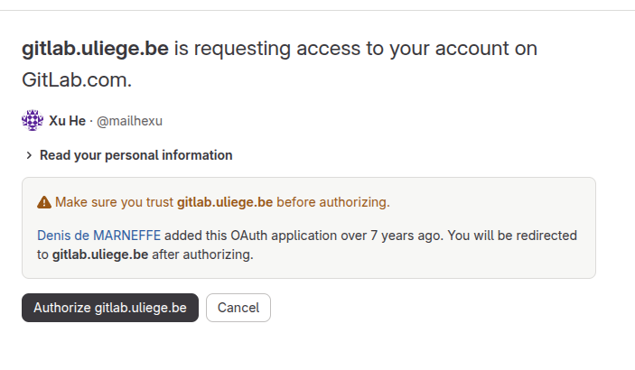
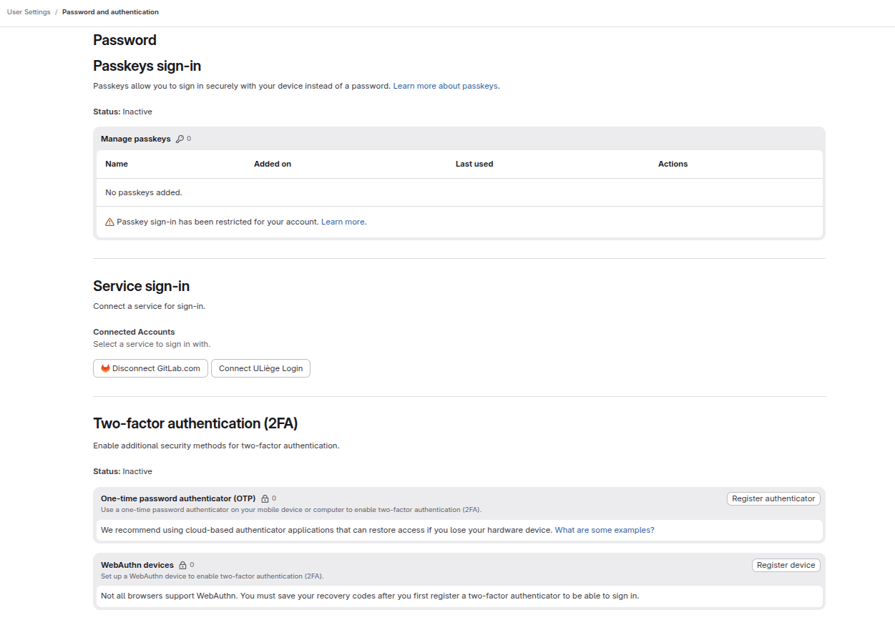
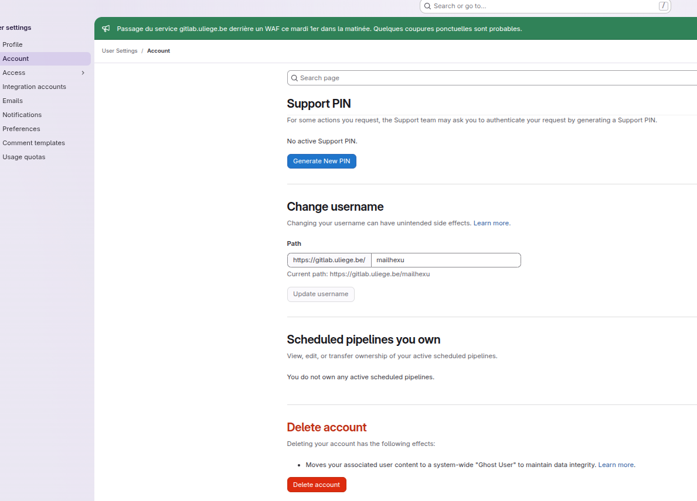
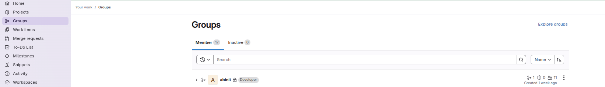
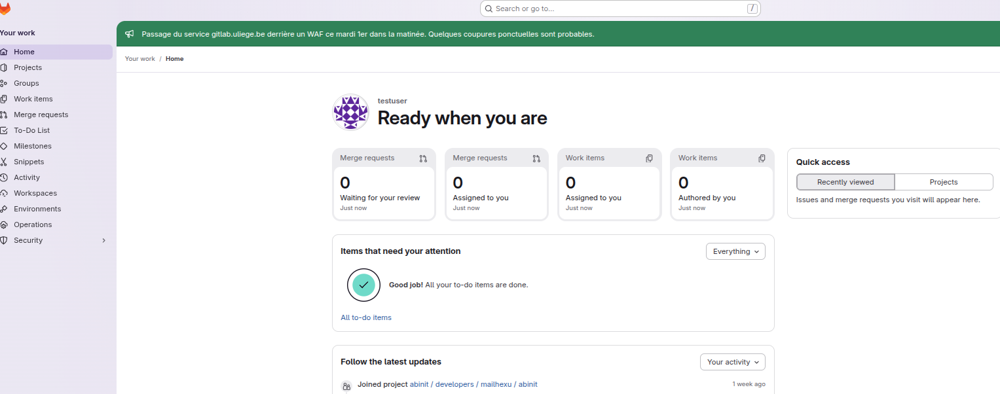
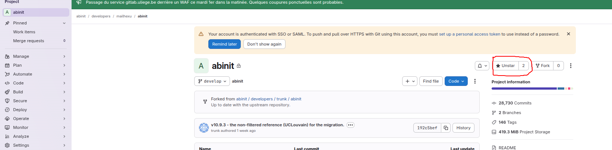
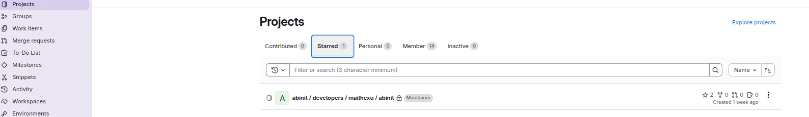
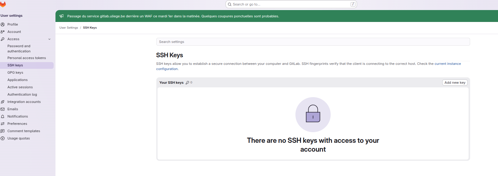
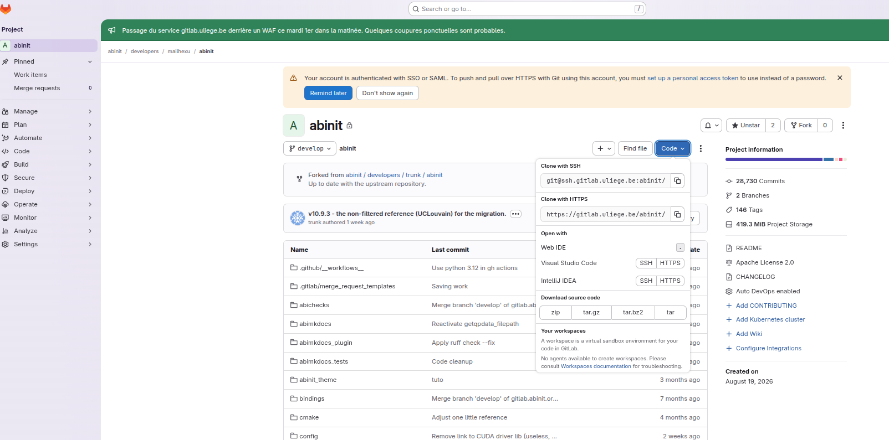

# Registering on gitlab.uliege.be with your gitlab.com account

This guide explains how ABINIT developers create their account on the
new ABINIT GitLab server (**https://gitlab.uliege.be**) by signing in
with their existing **gitlab.com** account, and how to configure it
(two-factor authentication, SSH key, finding your fork). It also
explains how to ask the technical team for access to the `abinit`
group and your personal fork.

## 1. Open the sign-in page

Go to **https://gitlab.uliege.be**. The sign-in page offers two
providers — choose **GitLab.com** (not *Uliège Login*, which is for
 University of Liège staff with a ULiège account).



## 2. Sign in with GitLab.com and authorize

You are redirected to gitlab.com. Sign in with your usual gitlab.com
username and password (e.g. `mailhexu`), then gitlab.uliege.be asks
permission to read your personal information from your gitlab.com
account. Click **Authorize gitlab.uliege.be**.



## 3. Account created — first sign-in

That's it: your gitlab.uliege.be account is created on the fly, with
the **same username** as your gitlab.com account (this is what the
administrators use to put you in the right groups and create your
fork, so nothing else to configure). You land on your Home page.

At the first login, you will be asked to set up two-factor
authentication (2FA). Two options are offered; pick one:

- **One-time password authenticator (OTP)** — the most common choice.
  Install an authenticator app on your phone (e.g. Microsoft Authenticator, Google
  Authenticator, Aegis, 1Password, etc), scan the QR code
  shown by GitLab, and enter the 6-digit code it displays to confirm.
- **WebAuthn device** — a hardware security key (YubiKey, etc.) or a
  passkey built into your browser/phone. Click *Register device* and
  follow the prompt.

**Important:** after registering, GitLab shows a list of **recovery
codes** — save them (print or store in a password manager). They are
the only way to sign in if you lose your phone or key. 2FA can be
managed later under *User settings → Password and authentication →
Two-factor authentication*.




## 4. (Recommended) Check the Account page

Open **https://gitlab.uliege.be/-/profile/account** to see your username ("Change username" section). 

https://gitlab.uliege.be/-/profile/account



> **Note — signing in later and HTTPS pushes.** Since the account is
> created through SSO (gitlab.com), there is no local password. For
> `git push`/`git pull` over **HTTPS** you must use a **personal
> access token** instead of a password
> (User settings → Access → Personal access tokens), or simply use
> **SSH** as described in step 7. You can also connect a ULiège login
> later under *Password and authentication → Service sign-in*.


-----

**Now please send the username to one of the members of the technical team, especially** 

- **HeXu [x.he@uliege.be](mailto:x.he@uliege.be)**

- **Marc Torrent   [marc.torrent@cea.fr](mailto:marc.torrent@cea.fr)** 

- **Xavier Gonze [xavier.gonze@uclouvain.be](mailto:xavier.gonze@uclouvain.be)**

  **If you are at a member of UCLouvain/CEA/ULiege, it is preferred that you send the request to the local one.** 

  You will be invited to the abinit group at gitlab.uliege.be, and a abinit fork will be created for you. 

-----


## 5. Your groups

Once you are a member of the `abinit` group. Check under **Your work → Groups**:
you should see `abinit` with your role (e.g. *Developer*).



## 6. Find your fork

Your personal fork of ABINIT lives at
**https://gitlab.uliege.be/abinit/developers/<username>/abinit**
(it is created for you by the administrators; if it doesn't exist
yet, ask them). Easiest way to find it: star it once, then it shows
up under **Your work → Projects → Starred**. The fork is where you
push your branches; the central repository
(`abinit/developers/trunk/abinit`) is where merge requests go.







## 7. Add an SSH key

For git over SSH (recommended), add your **public** key:
open **https://gitlab.uliege.be/-/user_settings/ssh_keys**
(User settings → SSH Keys) and click **Add new key**. If you don't
have a key yet, generate one locally with `ssh-keygen -t ed25519`
and paste the contents of `~/.ssh/id_ed25519.pub`.  You may need to specify a name for the key if you have multiple keys and don't want to get confused. 

https://gitlab.uliege.be/-/user_settings/ssh_keys



Optionally, tell SSH which key to use for this host by adding the
following to `~/.ssh/config` (create the file if it doesn't exist):

```
Host ssh.gitlab.uliege.be
    Hostname ssh.gitlab.uliege.be
    IdentityFile ~/.ssh/<your ssh key file name>
    User git
    AddKeysToAgent yes
    IdentitiesOnly yes
```

`IdentitiesOnly yes` makes SSH use exactly the key above, which
avoids failures when you have several keys; `AddKeysToAgent yes`
caches the passphrase in your SSH agent. Test with:

```bash
ssh -T git@ssh.gitlab.uliege.be
```

which should greet you with your gitlab.uliege.be username.

## 8. Clone your fork

On your fork's project page, click **Code** and copy the
**Clone with SSH** URL (`git@ssh.gitlab.uliege.be:...`), then:

```bash
git clone git@ssh.gitlab.uliege.be:abinit/developers/<username>/abinit.git
```

(If you prefer HTTPS, use the *Clone with HTTPS* URL and a personal
access token as the password — see the note in step 4. The full
migration workflow — moving your old branches to this fork — is
described in `migration_guide.md`.)



## 9. If SSH does not work: use HTTPS instead

Some networks block outgoing SSH connections (port 22), for example
corporate or campus firewalls. The HTTPS interface always works in
that case.

1. Create a **personal access token** on gitlab.uliege.be:
   avatar menu (top right) → *Edit profile* → *Access Tokens* →
   *Add new token*. Give it a name (e.g. `git-https`), tick the
   `read_repository` and `write_repository` scopes, and create it.
   **Copy the token now** — it is shown only once.
2. Clone over HTTPS (the *Clone with HTTPS* URL on the project page):

   ```bash
   git clone https://gitlab.uliege.be/abinit/developers/<username>/abinit.git
   ```

   When asked: username = your gitlab.uliege.be username, password =
   the personal access token (not your web password).

3. So you are not asked for the token on every pull/push, cache it
   (Git 2.34+):

   ```bash
   git config --global credential.helper store      # plain-text in ~/.git-credentials
   ```

   (or use `libsecret` on Linux / `osxkeychain` on macOS / `manager`
   on Windows to keep it in your system keyring instead of a file).

Switching an existing clone from SSH to HTTPS:

```bash
git remote set-url origin https://gitlab.uliege.be/abinit/developers/<username>/abinit.git
```

and back to SSH later with `git remote set-url origin
git@ssh.gitlab.uliege.be:abinit/developers/<username>/abinit.git`.


For your existing development, please follow another tutorial on how to migrate those to the new gitlab server. 


